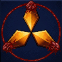

# Taradino

[](https://github.com/fabiangreffrath/taradino)

This is a port of Apogee's 3D action title Rise of the Triad, originally
released in 1994. This port duplicates the functionality of the original
game on modern operating systems, including Linux, Windows, and macOS.

Portability fixes include support for 64-bit and big-endian systems.

This port makes use of the Simple Direct Media Layer, or SDL, and an additional
library named SDL_mixer.
Optional OPL3/AdLib music synthesis is supported by using libADLMIDI.

## Features

- A single executable handles both the shareware and the registered version of
  the game; the version is detected at runtime from the game data found.
- The game renders at 320x200 or 640x400, both with aspect ratio correction.
  The user interface (status bar, messages, crosshair, ...) scales with the
  resolution.
- Optional OPL3/AdLib music synthesis using the DMXOPL bank when built with
  libADLMIDI.

## Game Data

Taradino requires the data files of the original game. It looks for
`darkwar.wad` (registered version) first and falls back to `huntbgin.wad`
(shareware version). If neither is found, the game exits with an error.

The data files are searched for in the following locations, in this order:

1. the current directory
2. the directory of the executable
3. the directory set at build time with `-DTARADINO_DATADIR=<path>`
4. `$XDG_DATA_HOME/games/rott` and `$XDG_DATA_DIRS/games/rott` (not on Windows)
5. the default installation directories of the Steam, GOG and Heroic versions

Savegames, high scores, the configuration and screenshots are stored in a
per-user directory, in a subdirectory named `darkwar` or `huntbgin`, depending
on the detected version.

## Known Issues

- Demos go out of sync.
- No netplay support.

## Building

Building Taradino requires GCC (or another C99 compiler), CMake, the
development packages for SDL2 and SDL2_Mixer (and libADLMIDI, if you like).
After installing, you can run the following commands to build:

```sh
cmake -B build -DCMAKE_BUILD_TYPE=Release -S.
cmake --build build
```

The following CMake options are available:

| Option                         | Description                                  |
| ------------------------------ | -------------------------------------------- |
| `TARADINO_DATADIR`             | Additional directory to search for game data |
| `TARADINO_WARNINGS_AS_ERRORS`  | Treat all compiler warnings as errors        |
| `TARADINO_ASAN`                | Build with Address Sanitizer                 |

Run `taradino help` for a list of command line parameters, or see the manual
page `taradino(6)`.

## Changes

See [CHANGELOG.md](CHANGELOG.md) for the list of changes between releases.

## Legalese

Files: `*`  
Copyright:  
 © 1993-1994, James R. Dose  
 © 1993-1996, Id Software, Inc.  
 © 1993-2008, Raven Software  
 © 1994-1995, Apogee Software, Ltd.  
 © 2002-2015, Steven Fuller, Ryan C. Gordon, John Hall, Dan Olson  
 © 2005-2018, Simon Howard  
 © 2006-2026, Fabian Greffrath  
 © 2023-2025, erysdren  
License: [GPL-2.0+](https://www.gnu.org/licenses/old-licenses/gpl-2.0.html)

Files: `rott/vgatext.*`  
Copyright:  
 © 2024, erysdren  
License: [MIT](https://opensource.org/licenses/MIT)

Files: `rott/vgafont.h`  
Copyright:  
 © Joseph Gil  
License: public-domain
